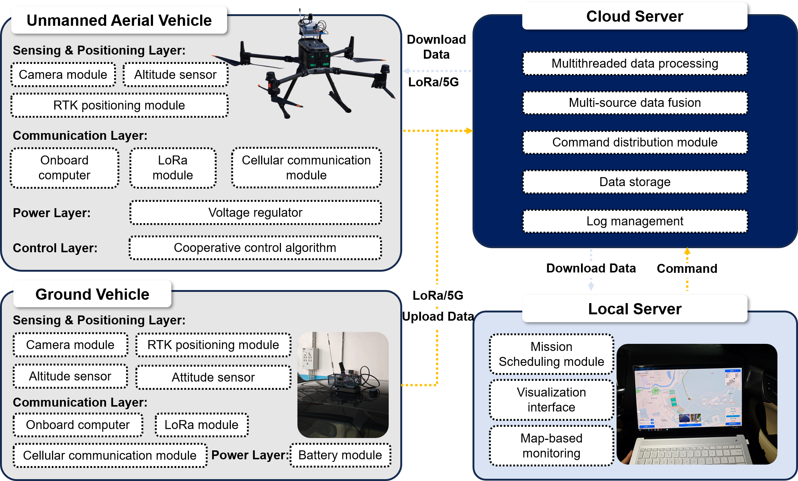

<div align="center">
<h1>Real-Time Air-Ground Cooperative Control with Onboard UAV Computation and Dual-Mode Communication</h1>

Jingjun Tan<sup>&dagger;</sup>, Qien Chen<sup>&dagger;</sup>, Binhan Sun,
Shimin Wang, Hengxing Cai, and Renxin Zhong<sup>*</sup>

Guangdong Provincial Key Laboratory of Intelligent Transportation Systems,
School of Intelligent Systems Engineering, Sun Yat-sen University, Shenzhen,
China

School of Data Science, Lingnan University, Tuen Mun, Hong Kong

<sup>&dagger;</sup>Equal contribution.
<sup>*</sup>Corresponding author: `zhrenxin@mail.sysu.edu.cn`
</div>

## Artifact Scope

OpenAGCS is the implementation and reproducibility artifact accompanying the
paper above. It contains the experiment-relevant sensing, dual-mode
communication, UAV supervision and control, operator interface, and offline
analysis code.

The repository supports two distinct workflows:

1. **Paper-result reproduction:** runs offline from the released CSV inputs and
   does not require flight hardware, Redis, MySQL, LoRa, or DJI PSDK.
2. **Distributed system deployment:** runs the communication and control
   modules on the remote server, GV computer, UAV computer, and operator
   workstation.

## Architecture



| Layer | Module | Experiment-relevant responsibility |
| --- | --- | --- |
| Interaction | [`Ground-Station`](Ground-Station/README.md) | Mission parameters, operator commands, confirmed mission state, and trajectory visualization |
| Communication | [`Commulication-Framework`](Commulication-Framework/README.md) | Local/remote APIs, timestamped telemetry, adaptive heading filtering, cellular state, and LoRa transport |
| Control | [`Vehicle-Controller`](Vehicle-Controller/README.md) | Dual-mode state supervision, safety state machine, Eq. (11) PD control, and absolute-yaw command generation |
| Execution | [`UAV-Executor`](Vehicle-Controller/UAV-Executor/README.md) | DJI ground-frame command execution, command watchdog, emergency latch, and shortest-path absolute yaw |
| Evaluation | [`Experiment-Analysis`](Experiment-Analysis/README.md) | Tracking, communication, separate closed-loop mode, heading, and platoon analysis aligned to the current R2 manuscript |

The historical directory spelling `Commulication-Framework` is retained so
that existing deployment scripts and source references remain valid.

## Requirements

| Workflow | Minimum requirements |
| --- | --- |
| Offline paper reproduction | Conda, Python 3.9 environment, approximately 2 GB free disk space |
| Ground Station | Conda, network access to the remote API, AMap Web JavaScript API key |
| Communication Framework | Linux recommended, Conda, Redis, optional MySQL, synchronized clocks, configured sensor/LoRa devices |
| Vehicle Controller | UAV Linux computer, Conda, reachable local and remote communication APIs |
| UAV Executor | Authorized DJI PSDK 3.9.1, supported Linux target, native compiler and libraries, aircraft credentials |

Internet access is needed only to install dependencies and, for the Ground
Station, to load the configured map service. The experiment analysis itself is
offline after the environment and repository are available.

## Quick Start: Reproduce The Paper Results

This is the recommended first check of the public artifact. Run the commands
from the repository root.

### 1. Create the Conda environment

```bash
cd Experiment-Analysis
conda create --name agcs-analysis python=3.9 pip -y
conda activate agcs-analysis
python -m pip install -r requirements.txt
```

### 2. Reproduce all tables and figures

```bash
cd Experiment-Analysis
.\run_paper_reproduction.ps1 -Python python
```

Generated artifacts are written to:

- `Experiment-Analysis/output/tables/`
- `Experiment-Analysis/output/figures/`
- `Experiment-Analysis/output/intermediate/`
- `Experiment-Analysis/output/analysis_summary.json`

Use `.\run_paper_reproduction.ps1 -Python python -TablesOnly` when figure rendering is not
required. This is the official paper-reproduction entry point; it validates the
pinned Python 3.9 environment and applies the audited NumPy CPU-dispatch setting
before importing the analysis stack.

## Quick Start: Distributed Deployment

The runtime stack is distributed. Do not run the UAV and GV local services
against the same Redis database.

Each runtime component uses an independent Conda environment:

| Module | Conda environment | Setup guide |
| --- | --- | --- |
| Communication Framework | `agcs-communication` | [Quick Start](Commulication-Framework/README.md#quick-start) |
| Vehicle Controller | `agcs-controller` | [Quick Start](Vehicle-Controller/README.md#quick-start) |
| Ground Station | `agcs-ground-station` | [Quick Start](Ground-Station/README.md#quick-start) |
| Experiment Analysis | `agcs-analysis` | [Quick Reproduction](Experiment-Analysis/README.md#quick-reproduction) |
| UAV Executor | `agcs-executor` | [Reproducible Deployment](Vehicle-Controller/UAV-Executor/README.md#reproducible-deployment) |

After installing and configuring the modules, start them in this order:

1. remote Communication Framework;
2. GV local Communication Framework and LoRa sender;
3. UAV local Communication Framework and LoRa receiver;
4. authorized DJI UAV Executor;
5. UAV Vehicle Controller;
6. Ground Station.

The module READMEs identify the required machine, configuration files, launch
command, and health check for each process.

## Released Data And Reproducibility

The public experiment artifact contains the controller, UAV, and trial-labelled
RTK trajectory CSV inputs required by the reproduction pipeline.
The original application logs are retained outside the public repository
because they are high-volume and dominated by repeated diagnostic and transport
records. `Experiment-Analysis/extract_data.py` documents the deterministic
log-to-CSV extraction used for the released data.

For Table V, the released controller CSVs preserve the same UGV state records
and timestamp field used in the paper's original calculation. The reproduction
therefore uses the same data basis and interval calculation as the paper.

The analysis pipeline records all input mappings and numerical parameters in
`Experiment-Analysis/manifest.json`. It exposes reconstructed timestamps,
causal alignments, communication modes, response fits, filter outputs, and
plotting series under `output/intermediate/`.

Table II speed statistics are reproduced from
`Experiment-Analysis/data/heading/*.csv` using centered linear
interpolation at 1.0 s before and after each valid sample. The resulting planar
displacement is divided by 2.0 s and converted to km/h before computing the
mean and P95.

The analysis project provides three independently runnable features:

- `tracking`: Tables II and IV, and Figures 5--8;
- `communication`: Table V and Figures 10--11;
- `closed_loop`: Table VI and Figures 12--13;
- `heading`: Tables VII, IX--XII and Figure 14;
- `platoon`: Table XIV and Figure 15.

The R2 manuscript-to-artifact inventory, including intentionally non-generated
figures, is maintained in [REPRODUCIBILITY_AUDIT_R2.md](REPRODUCIBILITY_AUDIT_R2.md).

See the [Experiment Analysis project guide](Experiment-Analysis/README.md) for
the feature commands, data contracts, output layout, and numerical methods.

## Availability Boundaries

- The GV was manually driven in the reported experiments. No autonomous UGV
  motion controller was used to generate the reported results.
- The DJI executor overlay source is public. DJI PSDK, aircraft-specific
  credentials, and the linked executable are not redistributed because they
  require separate DJI authorization and platform-specific deployment.
- Table VII evaluates raw GV yaw and the deployed AKF against an independent
  RTK-derived course angle during valid moving segments. The reference and
  metrics use only `Experiment-Analysis/data/heading/*.csv`.
- Figure 5 is reproduced offline without the network-fetched Esri basemap used
  as a background in the archived visualization.

## Demo

<p align="center">
  
</p>

[Demonstration video](https://youtu.be/gD_MNeUHup0)

## Citation

```bibtex
@article{
  title   = {Real-Time Air--Ground Cooperative Control with Onboard UAV Computation and Dual-Mode Communication},
  author  = {Tan, Jingjun and Chen, Qien and Sun, Binhan and Wang, Shimin and Cai, Hengxing and Zhong, Renxin},
  year    = {2026}
}
```

## License

See [`LICENSE`](LICENSE) for the repository license.
